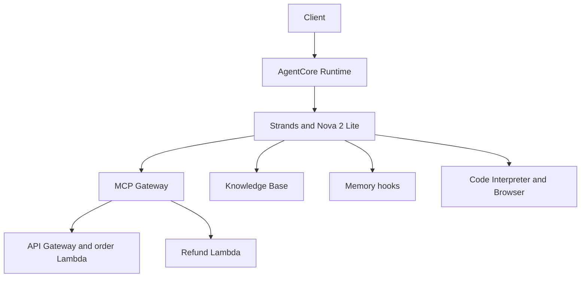

# Customer Support Agent with Strands and Amazon Bedrock AgentCore

Udacity AWS AI & ML Nanodegree · Project 2 · Attempt 2

Author: [Aarush Rajan Ranjan / Hatch5t](https://github.com/Hatch5t)

A customer-support agent for a fictional store. Amazon Nova 2 Lite selects tools through Strands; AgentCore Runtime hosts the application. The agent tracks fixture orders, simulates refunds, retrieves product policies, remembers customer preferences, calculates loyalty discounts and browses webpages.

**Attempt 2 verification, October 29, 2026:** all 35 offline regressions pass. Genuine hosted screenshots show order tracking, fresh cross-session Memory, the complete loyalty JSON response and Runtime version 2 in READY state. The Gateway and loyalty-schema corrections are preserved from `d3ee0cd`; accepted RAG, Browser and Reflection implementations are unchanged. This is a submission package, not a claim that Udacity has graded Attempt 2.

[Reviewer checklist](docs/SUBMISSION_CHECKLIST.md) · [Evidence index](evidence/README.md) · [Reviewer audit](docs/RUBRIC_AUDIT.md) · [Validation](docs/VALIDATION.md) · [Detailed setup](starter/README.md) · [Reflection](REFLECTION.md)

## Current hosted evidence

| Scenario | Verified result | Original evidence |
| --- | --- | --- |
| Runtime deployment | CustomerSupportAgent, READY, version 2; updated October 28, 2026 | [Runtime details](evidence/14_runtime_details.png) |
| Order tracking | ORD-001 request; SHIPPED, UPS, TRK987654321, October 31 delivery | [Command and hosted response](evidence/09_hosted_order.png) |
| Memory Session A | Fresh fictional actor introduces Jane, short bullet-point answers and board games | [Payload, Runtime ID and acknowledgement](evidence/10_memory_A.png) |
| Memory Session B | Same actor, different application/Runtime IDs; recalls all three facts without them in the request | [Payload, Runtime ID and recall](evidence/11_memory_B.png) |
| Loyalty | All eight JSON fields; 4,000 points redeemed, $40 points discount, 10% tier rate, $11 tier discount, $99 total, $51 saved, 99 earned, 349 remaining | [Command and hosted JSON response](evidence/13_loyalty.png) |
| Refund, RAG and Browser | Original genuine demonstrations preserved; no unnecessary AWS retest | [Historical evidence and limits](evidence/README.md#preserved-historical-evidence) |

Two verification limits remain explicit. The loyalty screenshot displays the **agent's JSON response**, not a raw Code Interpreter result event. Source and executed offline regressions verify the structured tool contract and arithmetic. Runtime metadata and the matching **local** source digest do not establish deployed-package byte identity: anonymous read-only access to the recorded S3 artifact returned HTTP 403. Neither limitation is hidden or represented as a verified execution trace. [Full provenance and limits](docs/ATTEMPT2_VERIFICATION_REPORT.md).

## Architecture



The module creates one `BedrockAgentCoreApp`. Its asynchronous `@app.entrypoint` handler validates the prompt, selects the customer/application session IDs and builds a new Strands agent. `app.run()` starts the Runtime server.

- **Gateway:** MCPClient uses Streamable HTTP to discover and retain API-backed order tools and Lambda-backed refund tools during invocation. Connection, timeout, discovery, empty-tool and cleanup failures are logged and mapped to a fixed safe availability response. Model errors remain separate.
- **RAG:** `search_knowledge_base` calls Bedrock Knowledge Base Retrieve and returns policy/catalog passages to the model. Citations are not rendered in the final answer.
- **Memory:** hooks retrieve semantic facts/preferences before reasoning and save the original customer query plus assistant response afterward. Actor namespaces persist across sessions; extraction is asynchronous. Full raw chat history is not automatically replayed.
- **Code Interpreter:** the tool generates self-contained Decimal-based Python, invokes `executeCode` with `clearContext=True`, parses the result JSON and requires all eight business fields. Unavailable/invalid execution takes an explicit tier-only fallback.
- **Browser:** the registered `AgentCoreBrowser.browser` tool retrieves web content. The accepted original capture shows tool calls and returned example.com content.

[Service boundaries and contracts](docs/ARCHITECTURE.md) · [Technical details](docs/TECHNICAL_DETAILS.md)

## Loyalty contract

Points are worth $0.01, redeemed in blocks of 500 and capped at 50% of order value. Tier discounts are applied **after** redemption. Silver/Gold/Platinum use 0%/10%/15%; standard/device/fresh earn 1/2/5 points per dollar of the final total.

For 4,250 Gold points and a $150 standard order: `$150 − $40 = $110`, then `$110 × 0.10 = $11`, leaving `$99`. New points are 99; the balance becomes `4250 − 4000 + 99 = 349`.

```json
{
  "points_redeemed": 4000,
  "points_discount": 40.0,
  "tier_discount_pct": 0.10,
  "tier_discount": 11.0,
  "final_total": 99.0,
  "total_savings": 51.0,
  "points_earned": 99,
  "remaining_points": 349
}
```

This contract is asserted against actual locally executed calculator code in [the offline tests](tests/test_remediation.py). The fallback exposes the same keys, `fallback: true`, zero points redeemed/earned, the unchanged balance and a clear tier-only message. It is never presented as successful sandbox execution. An earlier October 28 response incorrectly said $15 for the tier amount; that unchanged [historical transcript](evidence/13_loyalty_attempt2.txt) is retained for audit, and [October 29 screenshot 13](evidence/13_loyalty.png) is the current reviewer-facing result.

## Project structure

| Path | Contents |
| --- | --- |
| [starter/main.py](starter/main.py) | Completed agent and tools; original instructional comments retained |
| [starter/lambda/](starter/lambda/) | API Gateway order handler, direct refund handler and refund schema |
| [starter/pyproject.toml](starter/pyproject.toml), [uv.lock](starter/uv.lock) | Required dependencies and resolved lockfile |
| [starter/product_catalog.txt](starter/product_catalog.txt) | Demonstration Knowledge Base content |
| [tests/](tests/) | 35 offline Gateway, loyalty and preserved RAG regressions |
| [evidence/](evidence/) | 13 unmodified screenshots, historical transcripts, actual offline outputs and inspection metadata |
| [docs/](docs/) | Architecture, operations, audit, verification and reviewer checklist |
| [REFLECTION.md](REFLECTION.md) | Original accepted 285-word reflection |

## Installation and testing

Use Python 3.13+, uv and the project's Python AgentCore Starter Toolkit CLI. The newer npm CLI has a different project format; do not substitute it into this runbook. The existing AWS resources and an authorized profile are required for local application calls; cloning does not create infrastructure.

```bash
cd starter
uv sync --locked --python 3.13
```

Run regressions from the repository root; they stub external services and do not require AWS credentials:

```bash
python3 -m unittest discover -s tests -v
```

The final audit ran 35/35 successfully under Python 3.12.14 with SDK stubs. This validates the source logic, not full production dependency imports or a new Python 3.13 installation. The deployment requirement and lockfile remain unchanged. [Actual final test output and structured tool result](evidence/16_offline_verification_2026-10-29.txt).

Local server usage, authorized reproduction commands, resource setup and the direct-code deployment procedure are documented in [starter/README.md](starter/README.md). **No redeployment or repeat AWS test is needed for this submission.** The saved corrected application is already deployed; no infrastructure was changed during finalization.

## Security and limitations

This is a fixture-only educational application. Refunds are simulations. The unsigned Gateway, caller-controlled actor IDs and bypassed interactive consent require production authentication, ownership checks and transaction controls. Public source includes the configured Gateway endpoint; public visibility does not secure it. The owner should review authorization or disable the educational endpoint when no longer required. No visibility or AWS security setting was changed.

Current files, reachable Git history, 13 screenshots and the submission ZIP were checked for credential patterns; images were also reviewed visually and with OCR. No credential candidates were detected. The scanner is not a guarantee against every secret format. Account IDs, ARNs, source locations and session IDs remain visible as operational metadata. Credentials, environments, private deployment configuration and generated packages are excluded. [Security scope and validation limits](docs/VALIDATION.md).

## Udacity attribution and license

Based on [udacity/cd14763-project-starter](https://github.com/udacity/cd14763-project-starter). The original [LICENSE.txt](LICENSE.txt), educational notices and archived [project instructions](docs/upstream/UDACITY_PROJECT_INSTRUCTIONS.md) remain unchanged. No replacement open-source license is applied. See [attribution and redistribution notes](docs/UDACITY_ATTRIBUTION.md) before sharing. AWS, Strands and Udacity names identify the technologies and course; no endorsement is implied.
