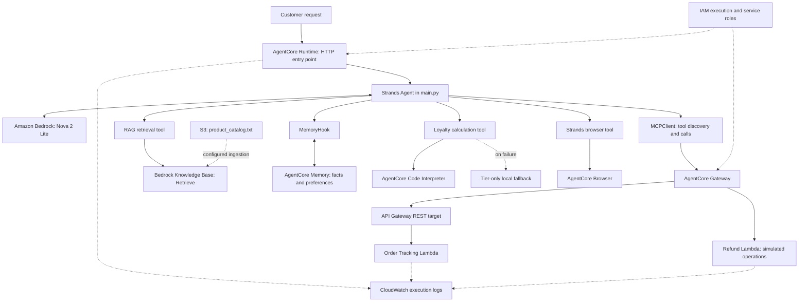

# AI Support Agent with Amazon Bedrock AgentCore and Strands SDK

**Model-driven support workflows with MCP tools, grounded answers, and customer memory.**

[](https://aws.amazon.com/bedrock/agentcore/)
[](https://aws.amazon.com/bedrock/)
[](starter/pyproject.toml)
[](https://strandsagents.com/)
[](docs/ARCHITECTURE.md)
[](docs/UDACITY_ATTRIBUTION.md)

A Python agent for a fictional e-commerce store that can look up orders, simulate refunds, retrieve product and policy information, remember preferences, calculate loyalty discounts, and browse live webpages. Amazon Nova 2 Lite selects the tools; Strands runs the agent loop; Amazon Bedrock AgentCore provides the hosted runtime and managed integrations.

Completed for **Project 2 of the Udacity AWS AI & ML Nanodegree**. This project is separate from the earlier customer-support chatbot.

> **Private educational repository.** Order/customer records are fixtures and refunds are simulations. AWS infrastructure must be configured separately. All **eight screenshots have been reviewed**; the evidence index distinguishes local tests, cloud deployment, and hosted invocation. See [licensing](docs/UDACITY_ATTRIBUTION.md) before sharing or changing visibility.

[Architecture](docs/ARCHITECTURE.md) · [Detailed setup](starter/README.md) · [Engineering notes](docs/TECHNICAL_DETAILS.md) · [Reflection](REFLECTION.md) · [Evidence](evidence/README.md) · [Submission checklist](docs/SUBMISSION_CHECKLIST.md)

## Project overview

The engineering focus is the boundary between language-model reasoning and concrete tool contracts. Order retrieval uses a REST proxy integration, refunds use direct Lambda tool arguments, Knowledge Base retrieval returns passages, and memory hooks add customer context before the agent reasons. Each capability has its own failure modes and permissions.

The implementation keeps those boundaries visible: one Runtime entry point, MCP tool discovery, explicit memory hooks, a retrieval tool, a remote computation tool with a reduced fallback, and a managed browser integration. The working Python source and dependency files are preserved from the completed project.

## Six core capabilities

| Capability | Example customer request | Implementation |
| --- | --- | --- |
| Order tracking | “Can you track order ORD-001?” | MCP Gateway → API Gateway → order Lambda |
| Simulated refunds | “Please refund my Kindle order ORD-002.” | MCP Gateway → refund Lambda |
| Grounded answers | “What is the electronics return policy?” | Knowledge Base `Retrieve` → Nova response |
| Cross-session recall | “Do you remember my communication preference?” | Semantic/user-preference records via `MemoryHook` |
| Loyalty calculation | “Apply my 4,250 Gold points to a $150 standard order.” | Code Interpreter tool with a tier-only fallback |
| Live web retrieval | “Visit example.com and report its heading.” | Strands browser tool → AgentCore Browser |

## Technology stack

| Layer | Technologies |
| --- | --- |
| Language and dependencies | Python 3.13, uv, `pyproject.toml`, `uv.lock` |
| Reasoning and orchestration | Amazon Nova 2 Lite (`global.amazon.nova-2-lite-v1:0`), Strands Agents SDK |
| Hosting and tool protocol | AgentCore Runtime, AgentCore Gateway, MCP Streamable HTTP |
| Business tools | Amazon API Gateway REST API, two AWS Lambda handlers |
| Retrieval and storage | Amazon Bedrock Knowledge Base, Amazon S3 catalog source |
| Context and managed tools | AgentCore Memory, Code Interpreter, Browser |
| Access and operations | AWS IAM, CloudWatch execution logs, Boto3 |

Resolved package versions and the Python Starter Toolkit compatibility notes are documented in [starter/README.md](starter/README.md#technology-stack).

## AWS architecture



The same handler can run in a local HTTP process. S3 ingestion and AWS service configuration are external setup, not automatic provisioning by `main.py`. The application does not fetch the catalog from S3 on every request. See [architecture boundaries](docs/ARCHITECTURE.md) for event contracts and trust boundaries.

## How a request is processed

1. A module-level `BedrockAgentCoreApp` receives a JSON payload with `prompt`, `customer_id`, and `session_id`.
2. The handler validates the prompt and generates UUIDs for missing actor/session IDs.
3. It constructs `MemoryHook` and Browser, connects to Gateway, and discovers MCP tools with `list_tools_sync()`.
4. A fresh Strands `Agent` receives those tools, the Knowledge Base and loyalty tools, and the Nova model.
5. The memory hook retrieves relevant stored records; Nova selects tools and composes the answer.
6. The completed user/assistant turn is saved as a memory event. The handler returns text from the first assistant content block.

Each invocation constructs a new agent. Saved events do not imply that a complete prior conversation is automatically replayed.

### MCP Gateway and business tools

The order handler expects API Gateway proxy events for `GET /orders/{order_id}`, `GET /customers/{customer_id}/orders`, and `GET /customers/{customer_id}`. The refund handler receives direct tool arguments and dispatches using `bedrockAgentCoreToolName` in Lambda client context.

The refund [schema](starter/lambda/lambda_schema) exposes `initiate_refund`, `check_refund_status`, and `get_return_label`. Refund IDs and return labels are simulated; there is no payment processor or persistent refund database. [Integration details](starter/README.md#gateway-tools-and-workflows).

### RAG and Knowledge Base retrieval

`search_knowledge_base()` calls the Bedrock Knowledge Base **Retrieve** API and returns text chunks to Nova. The educational [catalog](starter/product_catalog.txt) supplies products, policy rules, and loyalty information after separate S3 ingestion. The implementation does not return structured retrieval citations. [RAG details](starter/README.md#knowledge-base-rag).

### Cross-session memory

`MemoryHook` searches the configured semantic and user-preference namespaces before reasoning and saves each completed turn afterward. Recall requires a stable customer ID and asynchronous extraction. The reported cross-session test succeeded after retry. The application does not restore raw session history across requests. [Memory details](starter/README.md#short-term-and-long-term-memory).

### Code Interpreter and loyalty arithmetic

The tool sends Python using `Decimal` to AgentCore Code Interpreter. It redeems whole 500-point blocks, caps points redemption at 50% of order value, then applies the tier discount and awards new points.

For 4,250 points, Gold tier, and a $150 standard order, the expected complete breakdown is **4,000 points redeemed, $40 points discount, $11 tier discount, $99 final total, $51 savings, 99 points earned, and 349 remaining points**.

A failure returns a reduced, explicitly marked tier-only calculation. A correct final number alone does not independently prove that remote sandbox execution occurred. [Calculation and fallback](starter/README.md#loyalty-discount-computation).

### AgentCore Browser

The registered `AgentCoreBrowser.browser` tool supports live webpage access. Screenshot 06 shows browser-tool calls and returned example.com content. The manually opened Safari window is separate from the managed AgentCore Browser; no remote-session visual stream is claimed. [Browser details](starter/README.md#agentcore-browser).

## Verified Demonstrations

**Eight genuine captures, reviewed against the source.** The local screenshots invoke the application entry point directly from Python; they use AWS integrations while executing outside hosted Runtime. No live agent or AWS tool operation was repeated for this review.

| Demonstration | Verified content | Execution | Screenshot |
| --- | --- | --- | --- |
| Order tracking | Order MCP tool, `ORD-001`, `SHIPPED`, carrier/tracking/delivery | Local application | [01 · Order](evidence/01_order_tracking.png) |
| Simulated refund | Refund MCP tool, `ORD-002`, `APPROVED`, $139.99 | Local application | [02 · Refund](evidence/02_refund_processing.png) |
| Knowledge Base RAG | `search_knowledge_base`; demonstration 15-day electronics policy | Local application | [03 · RAG](evidence/03_rag.png) |
| Cross-session memory | Two session IDs; successful retry recalls bullet-point style and electronics | Local application | [04 · Memory](evidence/04_cross_session_memory.png) |
| Loyalty calculation | Calculator call; 4,000 redeemed, $40 + $11 discounts, $99 total, 349 points remaining | Local application | [05 · Loyalty](evidence/05_loyalty_discount.png) |
| Browser retrieval | Browser calls; example.com heading and paragraph | Local application | [06 · Browser](evidence/06_agentcore_browser.png) |
| Successful deployment | Direct Code Deploy command and Deployment Success output | Cloud deployment | [07 · Deployment](evidence/07_deployment_success.png) |
| Hosted order invocation | `agentcore invoke`; cloud response for `ORD-001` | Cloud Runtime | [08 · Cloud invocation](evidence/08_cloud_invocation.png) |

The lower successful retry in the memory capture is credited; its earlier failed recall is not. The loyalty capture verifies the complete numerical answer and tool selection, **not independent sandbox execution**. The browser evidence is the terminal tool calls/response; the Safari window is not represented as a managed browser session.

The [evidence index](evidence/README.md) explains each capture and its limits. [Local runbooks](starter/README.md#six-verified-local-scenarios) provide repeat-test examples rather than an exact transcript of every uploaded command.

## Successful cloud deployment

Screenshot 07 shows deployment success, and screenshot 08 shows a successful hosted `ORD-001` invocation. The author reports Runtime reached READY; no fresh status query was made during this review. Six independently repeated cloud scenarios are not claimed.

The deployment capture also shows an X-Ray/CloudWatch trace-delivery configuration warning. Deployment succeeded, but complete observability is not established. Private configuration and generated archives remain excluded.

The [45-check audit](docs/RUBRIC_AUDIT.md) finds no mandatory code-pattern failure in the supplied A–G criteria. Independent Code Interpreter execution and the unavailable official classroom rubric remain explicitly unverified.

## Installation and configuration

Prerequisites: Python 3.13, uv, AWS CLI v2, authorized AWS credentials, and the separately configured AWS integrations. Cloning alone does not provision them.

```bash
git clone https://github.com/Hatch5t/aws-ai-support-agent-strands-agentcore.git
cd aws-ai-support-agent-strands-agentcore/starter
uv sync --python 3.13 --locked
```

Use the existing Python Starter Toolkit environment. The installed toolkit version is deprecated; its commands differ from the newer npm AgentCore CLI. Avoid mixing executables. See the [compatibility explanation](starter/README.md#prerequisites-and-local-installation).

The unchanged `main.py` uses module-level `GATEWAY_URL`, `KB_ID`, `REGION`, and `MEMORY_ID` constants. It already contains account-specific settings. These are not environment-variable overrides, and no `.env` loader is implemented. Credentials must remain external to Git. See [AWS configuration](starter/README.md#aws-configuration) for temporary-profile guidance and illustrative resource placeholders.

The educational client opens an unsigned Gateway connection. This private copy preserves that implementation; securing it and removing embedded endpoint identifiers requires a separate authorized source change before broader sharing or production use.

## Local testing

From `starter/`, start the saved HTTP entry point:

```bash
uv run --locked main.py
```

In another terminal:

```bash
curl --fail-with-body -X POST http://localhost:8080/invocations \
  -H 'Content-Type: application/json' \
  -d '{"prompt":"Can you track order ORD-001?","customer_id":"CUST-123","session_id":"local-order-1"}'
```

The payload is the direct JSON object. The top-of-file JSON CLI example refers to a dormant helper; `app.run()` starts the server in the saved version. Local requests still call AWS and may write memory events. The uploaded local captures instead use a direct Python call to the async `invoke()` handler; that does not start or prove an HTTP-server test. [Full local test instructions](starter/README.md#local-invocation).

## Deployment instructions

The following is a reproduction procedure for an authorized deployment, not a request to redeploy the completed project:

```bash
# From starter/, using the Python Starter Toolkit CLI
uv run --locked agentcore configure \
  --entrypoint main.py \
  --name CustomerSupportAgent \
  --region us-east-1 \
  --deployment-type direct_code_deploy \
  --runtime PYTHON_3_13 \
  --requirements-file pyproject.toml \
  --disable-memory

uv run --locked agentcore deploy
```

Direct Code Deploy packages Python and Linux ARM64 dependencies for Runtime. `--disable-memory` disables toolkit-created memory, not the explicit application `MemoryHook`. Inspect existing settings before reconfiguring any deployed agent.

The existing `setup_permissions.py` helper has a no-AWS-call `--dry-run` option. Running it without that flag **changes IAM**, and it grants KB, Memory, and Browser actions rather than all integration permissions. Read the [complete deployment and permissions procedure](starter/README.md#agentcore-runtime-deployment) before any future deployment.

## Engineering challenges and lessons

| Challenge | Implemented response / lesson |
| --- | --- |
| Python 3.13 / Linux ARM64 native dependency compatibility | Pin `lazy-object-proxy==1.12.0`; the lockfile and original archive contain compatible artifacts |
| Memory extraction delay | Allow asynchronous extraction; cross-session recall succeeded after retry |
| Different tool event contracts | Keep API Gateway proxy routing distinct from direct Gateway Lambda arguments |
| Retrieved context leaking into saved queries | Preserve the original user text before memory-context injection |
| Remote calculation availability | Return an explicit tier-only fallback and distinguish it from complete results |
| Reproducibility across environments | Local `uv sync --locked` preserves the lock; the inspected toolkit's deployment resolver is not proven to freeze all transitive dependencies |

Read the [reflection](REFLECTION.md) and [technical notes](docs/TECHNICAL_DETAILS.md) for the design rationale and evidence boundaries.

## Security considerations and known limitations

- **Access boundaries:** the Gateway client is unsigned, customer IDs are caller-controlled, and tool consent is bypassed for headless execution. Production needs authenticated identities, secure Gateway access, ownership checks, and explicit controls for state-changing operations.
- **Data protection:** memory and logs can retain prompts or tool payloads. Define access restrictions, encryption, retention, deletion, and customer-memory isolation. Both Lambda handlers currently log incoming events.
- **Repository hygiene:** credentials, environment files, private deployment settings, logs, and dependency archives are excluded. The unchanged source retains resource identifiers; private visibility is essential and does not make the service secure.
- **Application limits:** business data is mocked, refund state is not durable, KB citations are not rendered, raw conversation history is not replayed, and Gateway discovery is required per invocation.
- **Verification limits:** eight screenshots are reviewed, all-six cloud coverage is not established, sandbox execution is not independently verified, and no load test, penetration test, or production-readiness certification is claimed.

See the [validation record](docs/VALIDATION.md), [full security discussion](starter/README.md#security-and-production-considerations), and [limitations](starter/README.md#known-limitations).

## Repository guide

| Location | Purpose |
| --- | --- |
| [starter/README.md](starter/README.md) | Detailed implementation, installation, configuration, and test runbooks |
| [starter/main.py](starter/main.py) | Completed agent with original instructional comments retained |
| [starter/lambda/](starter/lambda/) | Order/refund Lambda handlers and refund tool schema |
| [docs/ARCHITECTURE.md](docs/ARCHITECTURE.md) | Service paths, event contracts, and trust boundaries |
| [docs/TECHNICAL_DETAILS.md](docs/TECHNICAL_DETAILS.md) | Lifecycle, arithmetic, memory, packaging, and operational notes |
| [REFLECTION.md](REFLECTION.md) | 200–400 word project reflection |
| [docs/RUBRIC_AUDIT.md](docs/RUBRIC_AUDIT.md) | 45 source/evidence checks with exact line references and remaining qualifications |
| [docs/SUBMISSION_CHECKLIST.md](docs/SUBMISSION_CHECKLIST.md) | Completed checks and remaining manual submission actions |
| [evidence/README.md](evidence/README.md) | Index of all eight genuine, reviewed screenshots |
| [docs/upstream/UDACITY_PROJECT_INSTRUCTIONS.md](docs/upstream/UDACITY_PROJECT_INSTRUCTIONS.md) | Original upstream README preserved verbatim |

## Udacity attribution and author

Built by **[Aarush Rajan Ranjan / Hatch5t](https://github.com/Hatch5t)** for Udacity Nanodegree Project 2, based on the [Udacity AgentCore starter](https://github.com/udacity/cd14763-project-starter). AWS, Strands, and other product names identify technologies used; no endorsement is implied.

The original [LICENSE.txt](LICENSE.txt) is unchanged. It contains educational-content restrictions referencing CC BY-NC-ND and a 3.0/4.0 version inconsistency. No replacement open-source license is applied. Keep this repository private; public redistribution and sharing of modified starter content require clarification. [Full attribution and licensing notes](docs/UDACITY_ATTRIBUTION.md).
