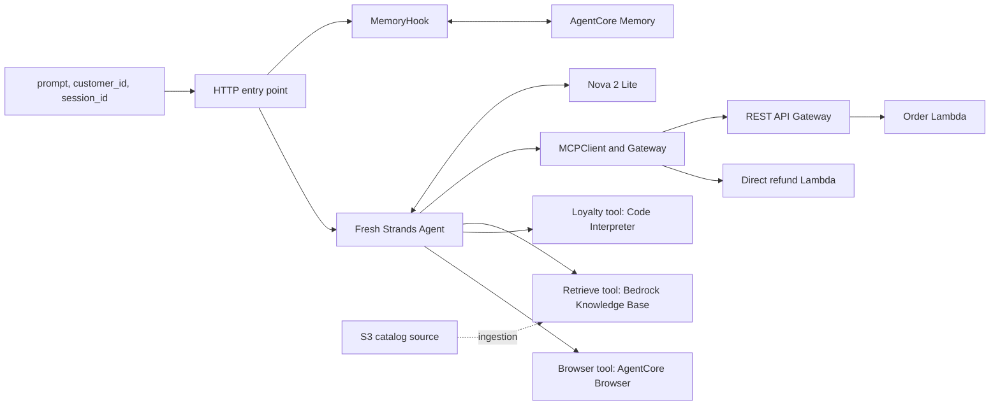

# Architecture and integration boundaries

[Project overview](../README.md) · [Implementation reference](../starter/README.md) · [Technical details](TECHNICAL_DETAILS.md)

## Execution model

The application is an HTTP agent hosted by Amazon Bedrock AgentCore Runtime. A single module-level `BedrockAgentCoreApp` registers the async `invoke()` handler. The handler creates a fresh Strands agent for each payload and uses `global.amazon.nova-2-lite-v1:0` through `BedrockModel`.

The same code starts a local HTTP server through `app.run()`. Local hosting still depends on the configured AWS services. Neither mode automatically provisions the business integrations, Knowledge Base, catalog ingestion, or Memory strategies.

## Service and event contracts

| Path | Contract visible in source | Configuration outside this repository |
| --- | --- | --- |
| Caller → Runtime | JSON `prompt`; optional actor/session IDs | Runtime hosting, inbound authorization, execution role |
| Agent → model | Strands `BedrockModel` and tool specifications | Bedrock access, IAM, regional/global profile availability |
| Agent → Gateway | Unsigned MCP Streamable HTTP; per-request tool discovery | Gateway inbound authorizer and target definitions |
| Gateway → order API | Three GET operations | REST API stage, operation names, Gateway API target |
| Order API → Lambda | Proxy event `resource`, `httpMethod`, `pathParameters` | Proxy integration and invoke permissions |
| Gateway → refund Lambda | Direct arguments; tool name in `context.client_context.custom` | Lambda target with imported `lambda_schema` |
| Agent → Knowledge Base | `bedrock-agent-runtime.retrieve()` | S3 upload, Knowledge Base, ingestion, service permissions |
| Memory hooks → Memory | Strategy namespace discovery, retrieve records, create events | Semantic and user-preference strategies |
| Loyalty tool → sandbox | `executeCode`, Python, `clearContext=True` | Code Interpreter permissions and availability |
| Browser tool → browser | Strands `AgentCoreBrowser(region=REGION)` | Browser permissions and service connectivity |

The source does not independently establish live Gateway target names, the Knowledge Base's embedding/storage configuration, or deployed strategy settings. Those are configuration-dependent, not inferred source-code facts.

## Data paths

**Orders and refunds:** order/customer records are fresh hardcoded dictionaries per Lambda call. The order handler normalizes identifiers; it is not a carrier integration or database client. Refund initiation returns a generated identifier and simulated approval. Status lookup and labels are demonstrations rather than persisted transaction state.

**RAG:** the S3 catalog is ingested into the Knowledge Base outside the application. The retrieval tool returns passage text to Nova and discards result locations and metadata. Source does not name an embedding model or vector store.

**Memory:** before reasoning, retrieved semantic/preference text is prepended to a plain-text user message. After reasoning, the original user query and assistant response are saved as an event. This is long-term retrieval plus event persistence, not automatic reconstruction of a raw multi-turn conversation across HTTP calls.

**Loyalty:** remote execution uses Decimal arithmetic. Errors or missing results produce an explicit local tier-only fallback. This reduced path is represented in the root diagram and must remain distinguishable in testing.

## Trust boundaries and observability

Customer identity currently comes from an untrusted payload field. Production authorization must bind the actor to an authenticated principal before accessing orders, tools, or memory namespaces. The educational Gateway connection is unsigned and the code bypasses interactive tool consent; production needs compatible authenticated access and server-side action controls.

IAM execution/service roles govern AWS integrations, while Gateway inbound access is a separate boundary. CloudWatch provides AWS execution logs; both Lambda handlers print events. There is no custom dashboard, alarm configuration, or application tracing setup in the supplied source.

KB passages, memories, webpages, and model tool arguments are untrusted inputs. The repository documents these risks but does not claim to implement a comprehensive prompt-injection defense, URL allowlist, or production transaction policy.

## Attempt 2 remediation boundary

Corrected source `d3ee0cd` adds scoped Gateway lifecycle handling, discovery/exception logging, empty-tool rejection and safe user responses. It preserves the transport, targets, model, RAG, MemoryHook and Browser registration. The loyalty contract adds fractional `tier_discount_pct` and exposes all eight business fields from the result event, with explicit consistent fallback.

Finalization integrates genuine screenshots showing READY Runtime version 2, hosted order success, fresh Memory A/B with both session layers distinct and complete displayed loyalty JSON. No functional source or AWS infrastructure was changed. [Evidence index](../evidence/README.md) · [Identifier/provenance inspection](ATTEMPT2_VERIFICATION_REPORT.md).

The hosted JSON is not a raw Code Interpreter trace. Runtime metadata and a local source hash do not establish deployed-package byte identity; anonymous artifact access returned HTTP 403. These disclosed limits do not change the verified architecture or source behavior.
