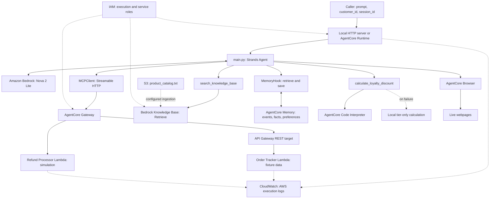

# AI Support Agent with Amazon Bedrock AgentCore and Strands SDK

Udacity AWS AI & ML Nanodegree — Project 2

**Author:** [Hatch5t](https://github.com/Hatch5t) · **Repository:** [aws-ai-support-agent-strands-agentcore](https://github.com/Hatch5t/aws-ai-support-agent-strands-agentcore)

A Python support agent for a fictional e-commerce store, combining Amazon Nova 2 Lite reasoning with MCP tools, retrieval-augmented generation (RAG), persistent customer memory, loyalty calculations, and live web retrieval. Strands controls the agent loop; Amazon Bedrock AgentCore Runtime hosts the completed application.

This README documents the inspected Project 2 implementation. It is separate from the earlier Project 1 customer-support chatbot. Order and customer records are fixtures, and refund operations are simulated; no payment is transferred.

> **Attempt 2 remediation:** Gateway/schema fixes are offline-tested; updated cloud deployment and hosted memory evidence await explicit approval. Public visibility and retained resource configuration are the author's updated choices. Preserve the Udacity license/notices. Cloning alone does not provision AWS infrastructure.

## Udacity Attempt 2 — Reviewer Feedback Addressed

The real Attempt 1 review passed RAG, Browser and reflection, but failed Gateway error handling, loyalty output schema, hosted invocation evidence visibility, and cloud two-session memory evidence. The prior broad code-pattern audit is superseded by [reviewer-driven findings](../docs/RUBRIC_AUDIT.md).

Gateway setup/cleanup now uses `gateway_tool_session()` with typed timeout/connection handling, unexpected-error logging, an empty-list guard and a safe fixed user response. `calculate_loyalty_discount` retains the correct arithmetic and sandbox invoke/result stream, adds fractional `tier_discount_pct`, and exposes all eight business keys from stdout/text JSON. Its fallback has the same keys, explicitly redeems/earns zero points, leaves the balance unchanged and labels reduced tier-only execution.

[Original genuine cloud invocation](../evidence/CLOUD_INVOCATION_ORIGINAL.md) · [35-test offline log](../evidence/12_offline_regression_tests.txt). New Attempt 2 deployment/order and hosted memory A/B evidence are not yet available; no placeholder success files are supplied. No live AWS operation is performed without explicit approval.

## Contents

- [Capabilities and verification scope](#capabilities-and-verification-scope)
- [Technology stack](#technology-stack)
- [Architecture](#architecture)
- [Agent orchestration](#agent-orchestration)
- [Gateway tools and workflows](#gateway-tools-and-workflows)
- [Knowledge Base RAG](#knowledge-base-rag)
- [Short-term and long-term memory](#short-term-and-long-term-memory)
- [Loyalty discount computation](#loyalty-discount-computation)
- [AgentCore Browser](#agentcore-browser)
- [Repository structure](#repository-structure)
- [Prerequisites and local installation](#prerequisites-and-local-installation)
- [AWS configuration](#aws-configuration)
- [Local invocation](#local-invocation)
- [AgentCore Runtime deployment](#agentcore-runtime-deployment)
- [Testing and evidence](#testing-and-evidence)
- [Technical challenges and resolutions](#technical-challenges-and-resolutions)
- [Security and production considerations](#security-and-production-considerations)
- [Known limitations](#known-limitations)
- [Udacity attribution and licensing](#udacity-attribution-and-licensing)

## Capabilities and verification scope

| Capability | Implementation | Reported verification |
| --- | --- | --- |
| Order tracking | Gateway → API Gateway → order Lambda | Successful locally; `ORD-001` also invoked in cloud Runtime |
| Refund processing | Gateway → refund Lambda | Successful locally; simulated approval |
| Product and policy answers | Bedrock Knowledge Base `Retrieve` tool | Successful local RAG scenario |
| Cross-session recall | Semantic and user-preference memory retrieval | Successful locally after retry |
| Loyalty breakdown | Code Interpreter tool with tier-only fallback | Complete numerical breakdown visible in screenshot 05; sandbox path unverified |
| Live web retrieval | Strands `AgentCoreBrowser` | Successful local webpage retrieval |
| Hosted execution | AgentCore Runtime, direct code deployment | Deployment Success and hosted `ORD-001` response visible in screenshots 07–08 |

The six functional results are supported by the eight reviewed captures indexed in [evidence/README.md](../evidence/README.md). The captured local tests call the async entry point directly from Python. They were not rerun during documentation preparation. All six scenarios are **not** claimed to have been independently repeated in deployed Runtime. A correct numerical response alone does **not** independently verify a Code Interpreter session or execution.

## Technology stack

Versions in the lockfile describe the inspected environment; minimum constraints in `pyproject.toml` are not the same as resolved versions.

| Technology or service | Role / inspected configuration |
| --- | --- |
| Python and uv | Python 3.13 deployment target; project declares `>=3.13`; uv manages the environment and lockfile |
| Strands Agents SDK | `strands-agents` locked to `1.61.1`; model-driven orchestration and hooks |
| Strands tools | `strands-agents-tools` locked to `0.8.9`; AgentCore Browser integration |
| Amazon Nova 2 Lite | `global.amazon.nova-2-lite-v1:0` via `BedrockModel` |
| AgentCore SDK | `bedrock-agentcore` locked to `1.24.1`; Runtime app, Memory, Code Interpreter |
| Python Starter Toolkit | `bedrock-agentcore-starter-toolkit` locked to `0.3.14`; project-specific `agentcore` commands |
| AgentCore Gateway / MCP | Streamable HTTP connection and tool discovery through `MCPClient` |
| Amazon API Gateway and AWS Lambda | REST proxy integration for order lookup; direct Lambda target for refunds |
| Amazon Bedrock Knowledge Bases | Retrieve relevant product/policy passages for RAG |
| Amazon S3 | Catalog data source and direct-deployment artifact storage |
| AgentCore Memory | Session events and long-term semantic/user-preference records |
| AgentCore Code Interpreter | Remote Python execution for the loyalty tool, when available |
| AgentCore Browser | Managed browser sessions for web retrieval |
| AWS IAM | Local credentials, Runtime execution role, service integration permissions |
| Amazon CloudWatch | AWS execution logs; no application-defined dashboards or alarms in source |
| Supporting packages | Boto3, PyYAML, MCP, Playwright, `lazy-object-proxy`; see the manifest and lockfile |

## Architecture

The same handler runs in a local HTTP process or in AgentCore Runtime. Local execution still uses real AWS services. The model selects tools; the Python handler establishes their clients and executes the agent loop.



Solid arrows show application interactions; dotted arrows show configuration, support services, or failure handling. The S3 ingestion and service relationships must be configured separately. The diagram makes no claim that a database, payment processor, infrastructure-as-code stack, or custom monitoring dashboard is included.

## Agent orchestration

The implementation resides in [main.py](main.py):

1. A single `BedrockAgentCoreApp` registers the async `invoke(payload, context=None)` entry point. Model, Memory, and Knowledge Base clients are initialized at module load.
2. The handler requires a non-empty string `prompt`. Missing or empty `customer_id` and `session_id` values receive generated UUIDs. Stable customer IDs are needed for cross-session recall.
3. Each request constructs a new `MemoryHook` and `AgentCoreBrowser`, then registers the Knowledge Base tool, loyalty tool, and browser tool.
4. `gateway_tool_session()` connects MCPClient to `GATEWAY_URL` using `streamable_http_client`. It handles context entry and discovery errors, rejects empty tools, logs the discovered count, and keeps the MCP context alive while the remote tools are used.
5. A fresh Strands `Agent` receives Nova 2 Lite, the tools, the memory hook, and a system prompt directing tool selection and identifying refunds as mock operations.
6. `agent.invoke_async(user_input)` runs reasoning and tool calls. The handler returns text from the first response content block.
7. Memory hooks retrieve customer context before reasoning and save the completed turn afterward. Retrieval/save failures are logged; Gateway failures return a fixed order/refund availability message; other invocation failures retain the generic retry response.

The code sets `BYPASS_TOOL_CONSENT=true` for headless operation. Tool availability does not guarantee that the model selected a particular tool on a particular request. Gateway discovery is performed for every invocation; a Gateway failure returns a specific availability message before unrelated capabilities run.

## Gateway tools and workflows

There are two different Gateway targets. Their event contracts must not be interchanged.

| Target | Operation | Input / behavior |
| --- | --- | --- |
| Order REST API | `GET /orders/{order_id}` | API Gateway proxy event; returns one mock order |
| Order REST API | `GET /customers/{customer_id}/orders` | Returns fixture orders matching that customer |
| Order REST API | `GET /customers/{customer_id}` | Returns fixture profile, points, and tier |
| Refund Lambda | `initiate_refund` | Required `order_id`, `reason`; optional numeric `amount` |
| Refund Lambda | `check_refund_status` | Required `refund_id`; returns simulated `PROCESSING` |
| Refund Lambda | `get_return_label` | Required `order_id`; returns a simulated label URL |

The three REST routes are implemented by [order_tracker.py](lambda/order_tracker.py). API operation names are assigned in the deployed API configuration; the upstream instructions suggest `get_order`, `get_customer_orders`, and `get_customer`. Actual discovered MCP names may include a `target_name___tool_name` prefix. No exported API definition is present to independently confirm deployed operation names.

The direct Lambda target uses [refund_processor.py](lambda/refund_processor.py) and the JSON tool definitions in [lambda_schema](lambda/lambda_schema). It reads `bedrockAgentCoreToolName` from `context.client_context.custom`, strips the target prefix, and dispatches using the bare tool name. It receives direct tool arguments rather than a REST proxy event.

### Order tracking

For “Track `ORD-001`,” the agent can call the order tool through Gateway and API Gateway. The fixture returns `SHIPPED`, carrier `UPS`, tracking number `TRK987654321`, and an estimated delivery date calculated as Lambda execution time plus two days. It is not a carrier tracking integration. Order/customer IDs are normalized to uppercase by the order handler.

The order Lambda also contains `ORD-002` and `ORD-003`, with mock profiles `CUST-123` and `CUST-456`. These are educational fixtures, not customer records supplied by a production system.

### Simulated refunds

For a request to refund `ORD-002`, the agent can first look up the order and then call `initiate_refund`. The Lambda produces a random `REF-XXXXXXXX` identifier, `APPROVED`, the supplied amount, a UTC timestamp, and a “3–5 business days” message. The handler defaults a missing amount to zero.

No payment provider, durable refund ledger, policy enforcement, or idempotency mechanism is implemented. `check_refund_status` always returns a mock `PROCESSING` result rather than looking up a previous approval. Return-label URLs are constructed examples, not real purchased labels or signed downloads. Model instructions do not replace server-side validation or authorization.

## Knowledge Base RAG

[product_catalog.txt](product_catalog.txt) contains the educational store catalog, return/refund rules, loyalty tiers, and order-status definitions. Its product and policy statements are fixture content, not a claim about current Amazon offerings or policies.

The project setup uploads this file to S3 and configures a Bedrock Knowledge Base with ingestion. The application does not create the bucket, Knowledge Base, data source, or ingestion job.

When Nova selects `search_knowledge_base(query)`:

1. The tool checks that `KB_ID` is populated and not an angle-bracket placeholder.
2. The `bedrock-agent-runtime` client calls `retrieve(knowledgeBaseId=KB_ID, retrievalQuery={"text": query})`.
3. Text chunks from `retrievalResults` are joined with `\n---\n` and returned to the agent.
4. Nova uses those passages to compose a response. Empty retrieval returns a clear no-results message.

This is a Retrieve-plus-agent generation flow, not `RetrieveAndGenerate`. The upstream project instructions specify a managed Knowledge Base; no exported live KB configuration independently confirms its embedding/storage settings. Source does not establish an embedding model, vector database, chunking policy, or retrieval count. The tool drops retrieval metadata and locations, so it does not provide structured citations.

## Short-term and long-term memory

| Layer | Actual behavior |
| --- | --- |
| In-request conversation | The Strands agent holds messages and tool results during its current invocation |
| Short-term event storage | `create_event` saves the user/assistant turn under the actor and session IDs |
| Long-term retrieval | Configured strategies extract records; `retrieve_memories` searches each strategy namespace |
| Across separate requests | A new Strands agent is created; previous raw session messages are not replayed by this implementation |

`get_namespaces()` reads configured strategies, preferring `namespaceTemplates` and falling back to legacy `namespaces`. The project instructions use semantic facts at `cs_agent/{actorId}/facts` and user preferences at `cs_agent/{actorId}/preferences`; the actual strategy definitions are owned by the separately configured Memory resource.

On `MessageAddedEvent`, `MemoryHook` processes a single plain-text user block, searches each namespace with `top_k=5`, labels results by strategy type, and prepends a `Customer Context:` section. It skips tool-result messages. On `AfterInvocationEvent`, it saves the original user query and last assistant text as a USER/ASSISTANT event pair. Preserving the original query avoids deliberately saving the injected context as the new query.

Long-term extraction is asynchronous. The capture shows recall succeeded after retry, so a first query immediately after saving may miss new records. Keep the same `customer_id` and use a different payload `session_id` for a cross-session test. Reusing a session ID alone does not restore the full transcript, and the payload ID is not the separate Runtime transport session ID used by the CLI.

## Loyalty discount computation

`calculate_loyalty_discount(loyalty_points, tier, order_total, product_category="standard")` builds self-contained Python using `Decimal` and `ROUND_HALF_UP`, then sends it to `code_session(REGION).invoke("executeCode", ...)` with `language="python"` and `clearContext=True`. It still processes the first result event, rejects execution errors/nonzero exit codes, and parses the printed business JSON from `structuredContent.stdout` or text content. The tool exposes all eight required business fields at the top level; incomplete output takes the explicit fallback.

The complete calculation follows these rules:

- Negative points and order totals are clamped to zero inside the sandbox calculation.
- Redeem only whole blocks of 500 points; each point is worth $0.01.
- Cap points redemption at 50% of the order value, rounded down to a 500-point block.
- Apply Silver 0%, Gold 10%, or Platinum 15% to the subtotal after points redemption.
- Round tier discount and final amount to cents; earn whole points on the final amount at 1× (`standard`), 2× (`device`), or 5× (`fresh`). Unknown tiers use 0%; unknown categories use 1×.
- Return points redeemed, points discount, fractional tier discount percentage, tier discount, final total, total savings, points earned, and remaining points including new earnings.

For the documented standard-order scenario (4,250 points, Gold, $150):

| Calculation | Expected value from the implementation |
| --- | --- |
| Points redeemed | 4,000 |
| Points discount | $40.00 |
| Subtotal after points | $110.00 |
| Gold tier discount fraction | 0.10 |
| Gold tier discount | $11.00 |
| Final total | $99.00 |
| Total savings | $51.00 |
| Points earned | 99 |
| Remaining points | 349 |

If Code Interpreter raises an error or supplies no usable result, the tool returns a **tier-only fallback** using local floating-point arithmetic, with `fallback: true` and an explanatory message. It exposes all eight keys with zero points redeemed/earned and the original points balance, rather than fabricating a complete sandbox result. A Gold $150 order would therefore return $15 tier discount and $135 final total in fallback mode.

Screenshot 05 shows the complete correct numerical breakdown. Independent Code Interpreter verification still requires session/tool execution evidence; the numbers alone cannot establish which execution path actually ran.

## AgentCore Browser

Each request creates `AgentCoreBrowser(region=REGION)` and registers its `.browser` tool. The system prompt directs the model to use it for current web information. Screenshot 06 shows local browser-tool calls retrieving example.com content. The separate Safari window is not treated as the managed session. The runbook below uses example.com; the archived upstream instructions retain their original Udacity.com example.

The managed browser requires AWS permissions and network access. Page content can change or block automation, and untrusted webpage text must be treated as data. The repository does not implement a URL allowlist, browsing policy, or application-level prompt-injection defense.

## Repository structure

This independent repository contains fresh Git history. Application files and the original license are copied unchanged; the original Udacity repository remains intact.

```text
aws-ai-support-agent-strands-agentcore/
├── README.md
├── REFLECTION.md
├── .gitignore
├── LICENSE.txt
├── starter/
│   ├── README.md
│   ├── main.py
│   ├── pyproject.toml
│   ├── uv.lock
│   ├── setup_permissions.py
│   ├── product_catalog.txt
│   └── lambda/
│       ├── order_tracker.py
│       ├── refund_processor.py
│       └── lambda_schema
├── docs/
│   ├── ARCHITECTURE.md
│   ├── TECHNICAL_DETAILS.md
│   ├── UDACITY_ATTRIBUTION.md
│   ├── SUBMISSION_CHECKLIST.md
│   ├── RUBRIC_AUDIT.md
│   ├── VALIDATION.md
│   └── upstream/
│       └── UDACITY_PROJECT_INSTRUCTIONS.md
└── evidence/
    ├── README.md
    ├── 01_order_tracking.png
    ├── 02_refund_processing.png
    ├── 03_rag.png
    ├── 04_cross_session_memory.png
    ├── 05_loyalty_discount.png
    ├── 06_agentcore_browser.png
    ├── 07_deployment_success.png
    └── 08_cloud_invocation.png
```

The original `.git` directory, `.DS_Store`, virtual environment, caches, raw `refund_test.json`, private `.bedrock_agentcore.yaml`, and generated dependency archive/hash were not copied. No deployment configuration or original Git history is imported. All eight real screenshots are tracked and reviewed; the [evidence index](../evidence/README.md) links each capture and states what it supports. The original [Udacity instructions](../docs/upstream/UDACITY_PROJECT_INSTRUCTIONS.md) supply the available project checklist; a standalone scoring rubric was not provided.

## Prerequisites and local installation

- Permission to use the Udacity starter content and an authorized AWS environment for live execution.
- Python 3.13, [uv](https://docs.astral.sh/uv/), and AWS CLI v2.
- AWS credentials with access to the separately configured services in `us-east-1` and the configured Nova global inference profile. Review cross-region data-routing requirements.
- Existing Lambda/API Gateway/Gateway, S3/Knowledge Base, and Memory resources with appropriate IAM roles.
- Optional Node.js for MCP Inspector; it is not needed to run the Python handler.

From the GitHub checkout:

```bash
git clone https://github.com/Hatch5t/aws-ai-support-agent-strands-agentcore.git
cd aws-ai-support-agent-strands-agentcore
git switch codex/attempt2-reviewer-remediation
cd starter
uv sync --python 3.13 --locked
```

The public clone does not require private repository access. For an existing local checkout, enter this independent repository's `starter/` directory. All subsequent project commands run from `starter/` unless stated otherwise.

Use `--locked` to reject an unintended lockfile change. Keep both [pyproject.toml](pyproject.toml) and [uv.lock](uv.lock). No `requirements.txt`, Dockerfile, or infrastructure template is included in this workspace.

This project uses the **Python Starter Toolkit CLI** installed by the lockfile. Its installed `0.3.14` release warns that the toolkit is no longer supported and recommends the newer npm AgentCore CLI. Preserve this environment for reproduction; migrating to the new CLI is separate work because its project format differs. Avoid having another `agentcore` executable shadow `uv run agentcore`. The commands below were checked against the installed toolkit's help and [AWS's Starter Toolkit command reference](https://github.com/aws/bedrock-agentcore-starter-toolkit/blob/main/documentation/docs/api-reference/cli.md).

### Python 3.13 / Linux ARM64 compatibility

A working macOS environment does not prove that native dependencies are compatible with the Linux ARM64 Runtime target. The installed toolkit packages dependencies using binary-only uv installs for ARM64 Linux platforms and the selected Python version.

The actual manifest pins `lazy-object-proxy==1.12.0`. The lockfile lists a CPython 3.13 ARM64 manylinux wheel for that version, and the existing dependency archive contains `lazy_object_proxy/cext.cpython-313-aarch64-linux-gnu.so` plus its `1.12.0` distribution metadata. This is the concrete compatibility resolution present in the project. The author identifies this as the deployment compatibility failure and resolution; the original failed-build transcript and failing package version were not retained, so no particular earlier version or error message is asserted.

Other constraints, including `chardet>=6.0.0.post1` and `urllib3>=2.6.3`, are retained; there is no evidence assigning the ARM64 issue to those packages. Local `uv sync --locked` uses the lockfile. The inspected toolkit's deployment packager resolves manifest requirements with `uv pip install --upgrade`; although it includes `uv.lock` in its cache hash, this does **not** establish that all deployed transitive versions are frozen to that lockfile. Preserve build evidence when reproducing deployment.

## AWS configuration

### Credentials

Use a named AWS CLI profile with temporary credentials or an existing approved role-based sign-in process. For an IAM Identity Center profile already configured on your machine, an example is:

```bash
aws sso login --profile your-profile
export AWS_PROFILE=your-profile
export AWS_DEFAULT_REGION=us-east-1
aws sts get-caller-identity
```

`your-profile` is an example profile name. The identity command is read-only, but its output contains account information; redact it from shared evidence. Never paste access keys, secret keys, or session tokens into source or screenshots. The deployed application uses its Runtime execution role, not a copy of local credential files.

### Application resource settings

The current implementation reads four **module-level constants in `main.py`**, not environment variables or a `.env` loader:

| Constant | Meaning | Illustrative value only |
| --- | --- | --- |
| `GATEWAY_URL` | Gateway MCP endpoint | `https://<gateway-id>.gateway.bedrock-agentcore.us-east-1.amazonaws.com/mcp` |
| `KB_ID` | Existing Knowledge Base ID | `<your-kb-id>` |
| `REGION` | AWS client region | `us-east-1` |
| `MEMORY_ID` | Existing AgentCore Memory ID | `<your-memory-id>` |

The checked-out source already contains real configured resource identifiers, which are deliberately not repeated here. The values in this table are explanatory placeholders, not working configuration. Setting similarly named environment variables will not override these constants. A different account requires an authorized source-configuration change before execution; this documentation task leaves the working source unchanged.

### Separately provisioned integrations

Follow the existing [upstream setup instructions](../docs/upstream/UDACITY_PROJECT_INSTRUCTIONS.md) with your own account and current service console options:

1. Deploy both Lambda handlers. For uploaded modules, use `order_tracker.lambda_handler` and `refund_processor.lambda_handler`; if pasting into the console's default `lambda_function.py`, use `lambda_function.lambda_handler`. The upstream instructions specify Python 3.12 for these functions, separate from the agent's Python 3.13 target.
2. Configure the three REST GET routes as Lambda proxy integrations to the order handler. Deploy an API stage and expose it through the Gateway API Gateway target.
3. Add the refund function as a direct Gateway Lambda target, importing `lambda/lambda_schema`. Configure Gateway outbound permissions for both integrations.
4. Upload `product_catalog.txt` to S3, configure the Knowledge Base, and finish ingestion before testing retrieval.
5. Configure semantic and user-preference Memory strategies and wait for the Memory resource to become active.
6. Ensure the caller/Runtime role can invoke the model and use Memory, KB retrieval, Browser, and Code Interpreter as required.

The source opens an **unsigned Gateway connection**. The starter setup assumes inbound authorizer `NONE`; the live authorizer was not queried during this documentation task. This setup is for an isolated educational sandbox. Authenticated production Gateway access would require matching client changes; changing the authorizer alone would break the current unsigned client. Runtime inbound invocation authorization is a separate boundary.

The optional `npx @modelcontextprotocol/inspector` command from the upstream guide can inspect the configured Gateway's tool list. Review its output for private endpoints before sharing.

## Local invocation

The saved `if __name__ == "__main__"` branch calls `app.run()`. Start the HTTP server in one terminal:

```bash
uv run --locked main.py
```

In a second terminal:

```bash
curl --fail-with-body http://localhost:8080/ping

curl --fail-with-body -X POST http://localhost:8080/invocations \
  -H 'Content-Type: application/json' \
  -d '{"prompt":"Can you track order ORD-001?","customer_id":"CUST-123","session_id":"local-order-1"}'
```

The payload is the direct JSON object, without an extra `input` wrapper. The installed SDK registers these endpoints on port 8080. This agrees with the [Starter Toolkit local quickstart](https://github.com/aws/bedrock-agentcore-starter-toolkit/blob/main/documentation/docs/user-guide/runtime/quickstart.md).

The top-of-file example `uv run main.py '{...}'` describes the dormant `main()` CLI helper; it does not invoke that helper in the saved server configuration. Use HTTP testing to preserve the application as-is. Local invocations incur AWS usage and can write memory events or call simulated tools; they are not offline tests.

## AgentCore Runtime deployment

These are reproduction instructions for a future authorized deployment. No deployment, IAM change, or cloud invocation was performed while preparing this documentation.

From `starter/`, using the Python toolkit environment:

```bash
uv run --locked agentcore configure \
  --entrypoint main.py \
  --name CustomerSupportAgent \
  --region us-east-1 \
  --deployment-type direct_code_deploy \
  --runtime PYTHON_3_13 \
  --requirements-file pyproject.toml \
  --disable-memory

uv run --locked agentcore deploy
```

For an already configured deployment, inspect the private local configuration before deciding whether reconfiguration is needed. The configure command writes local deployment settings; deploy creates or updates AWS resources and may incur charges. It packages code and Linux ARM64 dependencies into a ZIP for Runtime using S3; this project does not require a Dockerfile. [AWS documents the direct-code ZIP deployment model](https://docs.aws.amazon.com/bedrock-agentcore/latest/devguide/runtime-get-started-code-deploy-python.html).

`--disable-memory` prevents toolkit-managed memory creation during configuration. It does not disable the explicit `MemoryHook` using `MEMORY_ID` in this application. Supply or create an appropriate execution role through the toolkit prompts.

The existing permission helper can preview its policy after deployment configuration is available:

```bash
uv run --locked setup_permissions.py --dry-run
```

Its dry run reads source/configuration and prints a policy without AWS calls. The output includes private role/resource information. After review, the documented apply step is:

```bash
uv run --locked setup_permissions.py
```

**The apply command changes IAM.** It checks the caller account, Runtime role, KB, and Memory, then writes the role's `CustomerSupportIntegrations` inline policy. It grants scoped KB retrieval, Memory operations, and Browser session actions. It does **not** grant model invocation or Code Interpreter permissions; review those separately rather than assuming the helper covers every integration.

After Runtime is ready and permissions have propagated, invoke it using the saved private toolkit configuration:

```bash
uv run --locked agentcore invoke \
  '{"prompt":"Can you track order ORD-001?","customer_id":"CUST-123","session_id":"cloud-order-1"}'
```

Keep `.bedrock_agentcore.yaml` and generated deployment artifacts local. Do not copy the original account's deployment configuration into another account or infer infrastructure provisioning from this README.

## Testing and evidence

### Six verified local scenarios

The following are repeat-test examples against the **local** HTTP server. The uploaded captures instead call `asyncio.run(main.invoke(...))` directly using `uv run python -c`; they do not demonstrate HTTP-server invocations. No live tests were rerun for finalization. Compare output against tool results as well as final text; HTTP success alone is insufficient because the handler can return a generic error string.

**1. Order tracking — verified in screenshot 01.** Expect `ORD-001`, `SHIPPED`, UPS, and the fixture tracking number; delivery dates vary with execution date.

```bash
curl --fail-with-body -X POST http://localhost:8080/invocations \
  -H 'Content-Type: application/json' \
  -d '{"prompt":"Can you track order ORD-001?","customer_id":"CUST-123","session_id":"t1"}'
```

**2. Refund processing — verified in screenshot 02, simulated.** Expect an approval and refund identifier; verify the mock amount rather than treating it as a real transaction.

```bash
curl --fail-with-body -X POST http://localhost:8080/invocations \
  -H 'Content-Type: application/json' \
  -d '{"prompt":"I want to return my Kindle Paperwhite (ORD-002). Please initiate a refund.","customer_id":"CUST-123","session_id":"t2"}'
```

**3. Knowledge Base RAG — verified in screenshot 03.** The capture shows the electronics return-policy query and 15-day demonstration policy; the example below matches that topic. Raw retrieved chunks are not shown separately.

```bash
curl --fail-with-body -X POST http://localhost:8080/invocations \
  -H 'Content-Type: application/json' \
  -d '{"prompt":"What is the demonstration return policy for electronics, including the return window and conditions?","customer_id":"CUST-123","session_id":"t3"}'
```

**4. Cross-session memory — verified after retry in screenshot 04.** The actual capture uses `CUST-123`, `memory-test-A`, and `memory-test-B` to recall short bullet-point answers and electronics. Its earlier failed recall is not credited as success. Save a synthetic name/preference, allow at least 30 seconds for extraction, then recall with the same actor and a different session. Extraction may take longer; retry if records are not ready. Distinct synthetic content helps distinguish recall from names already in fixtures.

```bash
curl --fail-with-body -X POST http://localhost:8080/invocations \
  -H 'Content-Type: application/json' \
  -d '{"prompt":"For this synthetic test, call me Mira. I prefer concise responses in two bullet points.","customer_id":"CUST-MEMORY-DEMO","session_id":"memory-A"}'

# Wait for asynchronous memory extraction before the next request.
curl --fail-with-body -X POST http://localhost:8080/invocations \
  -H 'Content-Type: application/json' \
  -d '{"prompt":"Do you remember my name and communication preference?","customer_id":"CUST-MEMORY-DEMO","session_id":"memory-B"}'
```

The synthetic identity above is a proposed repeat-test input, not a claim about the exact original test transcript. Confirm both name and preference came from stored records.

**5. Loyalty calculation — complete numerical breakdown verified in screenshot 05.** The updated output includes all eight business fields, including `tier_discount_pct: 0.10`; the old screenshot predates that added field. Preserve tool/session evidence separately to verify remote Code Interpreter execution.

```bash
curl --fail-with-body -X POST http://localhost:8080/invocations \
  -H 'Content-Type: application/json' \
  -d '{"prompt":"I am a Gold member with 4250 points. Calculate my discount on a $150 standard order. Show points redeemed, points discount, tier discount, final total, total savings, points earned, and remaining points.","customer_id":"CUST-123","session_id":"t5"}'
```

**6. Browser — tool calls and example.com response verified in screenshot 06.** The terminal shows the page heading and first paragraph; the separate Safari window is not a managed-session capture.

```bash
curl --fail-with-body -X POST http://localhost:8080/invocations \
  -H 'Content-Type: application/json' \
  -d '{"prompt":"Use the browser tool to visit https://example.com and report the page heading and first paragraph.","customer_id":"CUST-123","session_id":"t6"}'
```

### Cloud deployment and invocation evidence

| Evidence | What is available | What it establishes / does not establish |
| --- | --- | --- |
| [Deployment screenshot 07](../evidence/07_deployment_success.png) | Direct Code Deploy and Deployment Success output | Successful deployment report; trace-delivery warning is also visible; current READY not independently queried |
| [Cloud screenshot 08](../evidence/08_cloud_invocation.png) | agentcore invoke and ORD-001 shipping response | One successful hosted order invocation, not all-six cloud coverage |
| [Local screenshots 01–06](../evidence/README.md) | Tool calls and the six demonstration responses | Successful local scenarios, with memory success after retry and sandbox-execution qualification |
| Original private configuration/archive (excluded) | Previously inspected Runtime metadata and Linux ARM64 dependencies | Configuration/packaging context; not a fresh service or execution check |

All eight screenshots are now included and reviewed. The required [285-word reflection](../REFLECTION.md) is present. Independent Code Interpreter execution remains unverified because the loyalty capture does not show a sandbox result/session trace. The [reviewer audit](../docs/RUBRIC_AUDIT.md) records actual feedback and pending live-evidence gates.

The reviewed deployment/cloud captures contain account identifiers and ARNs, which are not credentials. No active credential was visible, so the genuine images are retained unchanged in the original evidence set; the author has now authorized public visibility with the configuration retained. Redact operational details before broader distribution; do not expose the unchanged source's live Gateway endpoint publicly. No history rewrite or credential rotation was warranted solely by the identifiers reviewed.

## Technical challenges and resolutions

| Challenge | Resolution present in source/configuration | Evidence boundary |
| --- | --- | --- |
| Python 3.13 Linux ARM64 native dependency compatibility | Exact `lazy-object-proxy==1.12.0` pin; compatible wheel and archive binary present | Original failure log/version is missing |
| Memory namespace response differences | Prefer `namespaceTemplates`, fall back to `namespaces` | Directly visible in `get_namespaces()` |
| Polluting saved queries with retrieved context | Preserve `_original_user_query` before injection; save original text | Directly visible in `MemoryHook` |
| New memory unavailable immediately | Wait for extraction and retry cross-session recall | Screenshot 04 includes failed recall and successful retry; exact extraction latency not measured |
| Different order/refund event formats | REST proxy routing for orders; client-context tool routing for direct refunds | Lambda handlers and refund schema inspected |
| Remote interpreter unavailable | Explicit tier-only fallback with `fallback: true` | Fallback exists; independent remote execution proof missing |
| Running the completed server locally | Use `/invocations` HTTP requests with saved `app.run()` entry point | Source and installed SDK endpoints checked |

These rows describe implemented solutions and documented observations. They do not invent an original debugging chronology or unrecorded AWS changes.

## Security and production considerations

The current project is an educational demonstration. Before production use:

- **Authenticate and authorize requests.** The unsigned Gateway client assumes `NONE` inbound authorization. Require authenticated Gateway access with a compatible client, and independently protect Runtime/API access. Derive customer identity from a trusted authenticated principal; the payload's `customer_id` is currently caller-controlled.
- **Enforce ownership and business rules in tools.** The fixture Lambda handlers do not enforce order ownership or refund eligibility. Add validation, authorization, durable transaction state, idempotency, and approval controls before any real monetary action. Consent prompts are bypassed in the current source.
- **Separate and scope IAM roles.** Review Runtime, Gateway, Lambda, and Knowledge Base permissions independently. The existing helper only adds KB, Memory, and Browser permissions; model and Code Interpreter access need separate review. No blanket production IAM policy is supplied here.
- **Protect prompts, memory, and logs.** Both Lambda handlers print incoming events; order handling also logs path parameters. Exceptions may expose operational details. Sanitize logs, restrict access, set retention, and configure appropriate encryption. Define memory retention/deletion and customer isolation before storing real personal data.
- **Treat retrieved content as untrusted.** KB passages, saved memories, and browser pages may contain prompt injection. Validate tool arguments server-side and restrict browsing/code execution according to application policy.
- **Keep credentials outside Git.** Prefer temporary credentials/roles. The working code contains resource IDs and a live Gateway endpoint; these are not authentication secrets, but the endpoint is especially sensitive when access is unsigned. Review/sanitize configuration in a separate authorized change before wider sharing.
- **Review dependencies and build outputs.** Keep `uv.lock`; the local lock does not by itself prove frozen Runtime packaging. Do not commit `.venv`, dependency ZIPs, or private toolkit configuration. A vulnerability scan and full dependency/license audit were not performed in this task.
- **Add operational controls deliberately.** Rate limits, timeouts, retries/backoff, alarms, cost budgets, browser restrictions, and structured error handling are production work. Source does not demonstrate custom CloudWatch dashboards, tracing instrumentation, or service-level objectives.

The repository-wide [.gitignore](../.gitignore) excludes environments, Python/tool caches, `.env` secrets (with example/template exceptions), local AWS credentials/token files, `.aws/`, account-specific AgentCore settings, generated deployment data, logs, build outputs, temporary files, macOS files, and editor-local configuration. It retains source, `pyproject.toml`, `uv.lock`, the catalog, refund schema, documentation, configuration examples, and intentionally selected screenshots. The original raw `refund_test.json` was not copied; the ignore rule prevents accidental later inclusion.

Ignore rules do not remove tracked files or protect prior commits. This independent repository excludes the original tracked `.DS_Store` and starts with fresh Git history. Scan the exact staged content and new history before publication; see the [validation record](../docs/VALIDATION.md). The original preparation found no credential/token pattern matches in inspected project text and reachable historical blobs. The source still contains a live Gateway endpoint and resource IDs, so the author has explicitly chosen to retain these identifiers in the public copy; this is not a substitute for Gateway authorization. No scan is a guarantee that no secret exists.

## Known limitations

- Existing AWS infrastructure is required. There is no included automated end-to-end provisioning stack or exported live service configuration.
- All business records and refunds are demonstrations; dates and random refund identifiers vary.
- New agent instances do not replay raw short-term conversation history across requests. Long-term recall depends on extraction, retrieval relevance, and stable caller IDs.
- Account configuration is embedded in `main.py`; a `.env` file or similarly named environment variables cannot replace it automatically.
- Gateway discovery occurs on every request; there is no implemented degraded mode for Gateway failure.
- Knowledge retrieval returns text without source metadata/citation rendering. Some catalog entries contain product-specific return windows as well as general rules; preserve the fixture context rather than claiming universal current policies.
- Code Interpreter fallback provides fewer results than the complete calculation and uses different arithmetic. Independently verified remote execution is not established by the saved evidence.
- Only the first assistant content block is returned; exceptions become a generic text response that can hide a failed invocation from a status-only check.
- Tool choice and natural-language replies are nondeterministic. Full negative-case, concurrency, load, isolation, and all-six cloud regression testing are not evidenced.
- The pinned Python Starter Toolkit is deprecated. Migration, dependency upgrades, and production hardening require separate implementation and verification.

## Udacity attribution and licensing

This work completes **Project 2 of the author's Udacity AWS AI & ML Nanodegree**, based on Udacity's *Building a Customer Support AI Agent with Amazon Bedrock AgentCore* starter. The upstream README labels the course “AWS AI Engineering Nanodegree.” Starter scaffolding, Lambda examples, catalog content, comments, instructions, and existing copyright/license notices remain attributed to their respective owners. The completed agent implements the supplied TODO sections; retained TODO comments are part of the original instructional scaffolding.

The existing [LICENSE.txt](../LICENSE.txt) begins with **Copyright © 2012–2020, Udacity, Inc.** and grants educational-content rights subject to modified Creative Commons Attribution–NonCommercial–NoDerivatives terms where applicable. Its prose names a **3.0** license while its URL points to **4.0**; that inconsistency is preserved and needs review. The [CC BY-NC-ND 4.0 deed](https://creativecommons.org/licenses/by-nc-nd/4.0/) describes restrictions on distributing modified material. The applicable version, content markings, Udacity-specific modifications, course terms, and permission to redistribute this completed starter solution must be clarified with Udacity or the rights holder.

No MIT, Apache, or other replacement license is applied. This README does not grant rights to Udacity-owned content, and private visibility does not itself resolve permission for sharing with collaborators or recruiters. On 20 October 2026 the author confirmed public redistribution permission and requested public visibility with existing configuration retained. This confirmation does not replace the original license or independently resolve its version discrepancy.

**Author / repository owner:** [Hatch5t](https://github.com/Hatch5t). The GitHub destination is [Hatch5t/aws-ai-support-agent-strands-agentcore](https://github.com/Hatch5t/aws-ai-support-agent-strands-agentcore). This independent repository is publicly visible at the author's request; the original repository and deployed AWS resources are unchanged.
